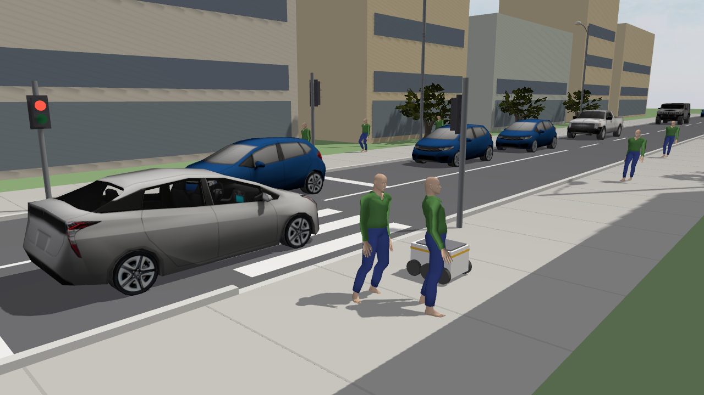
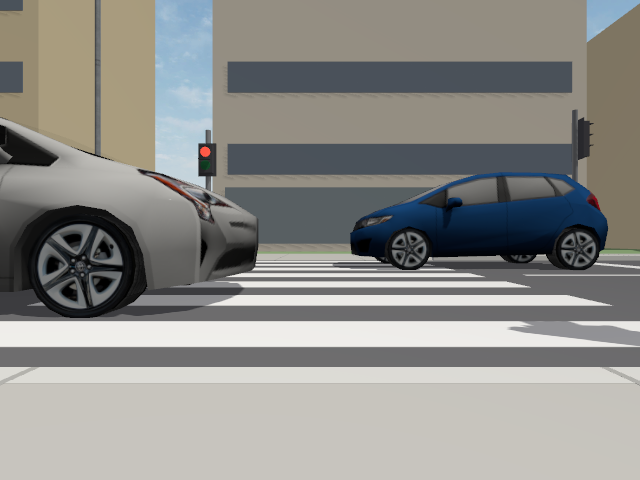
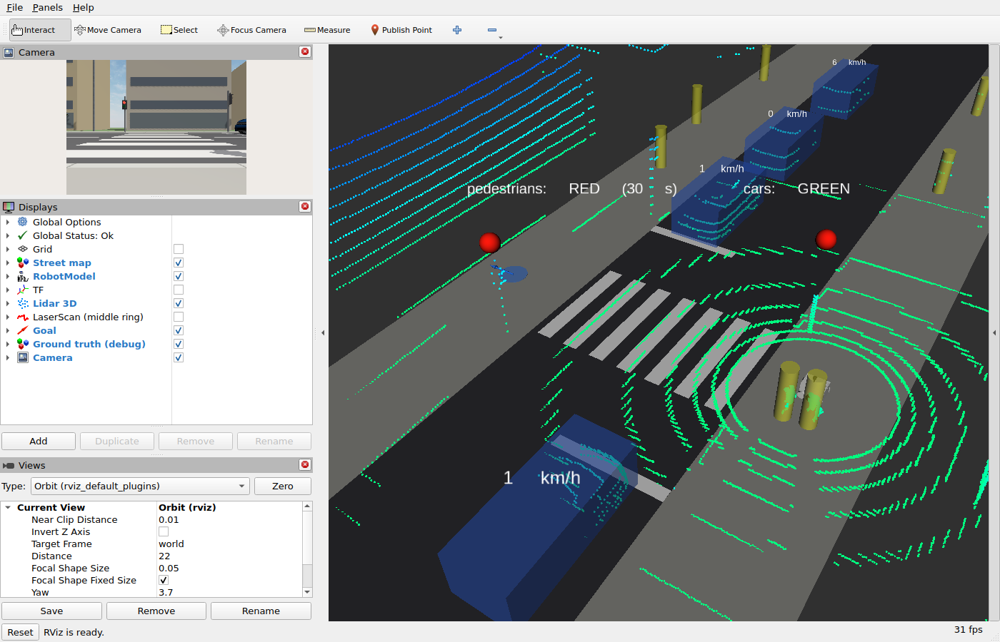

# arm_crosswalk_sim: delivery robot at a crosswalk (ROS 2 Jazzy + Gazebo Harmonic)

A sidewalk delivery robot has to cross a street at a pedestrian crossing with
traffic lights. Pedestrians walk around and cross, cars stop at red, and now and
then **a car runs the red light while pedestrians have GREEN**. This repository
is only the simulation. It does not contain a solution.



Demo video: [media/crosswalk_demo.mp4](media/crosswalk_demo.mp4). In the video a
naive robot, driven by a throwaway script (not included), starts on GREEN. A
red-light runner hits it and the referee scores the crossing `FAILED`.

| Robot camera (`/camera/image_raw`) | RViz: 3D lidar, map, ground-truth debug markers |
|---|---|
|  |  |

---

## 1. Quick start

### Docker (recommended)

The Docker image (Dockerfile and build/run scripts) is in
[LabARM/LabXX-Problem3](https://github.com/kamilmlodzikowski/LabARM/tree/main/LabXX-Problem3).
It clones this repository into `/arm_ws/src`, downloads the 3D models and
builds the workspace. Inside the container, run:

```bash
ros2 launch crosswalk_sim sim.launch.py
```

To open another terminal in the running container, for example to drive the
robot with the keyboard:

```bash
docker exec -it ARM_XX bash
```

```bash
ros2 run teleop_twist_keyboard teleop_twist_keyboard
```

### Without Docker (an existing ROS 2 Jazzy installation)

```bash
cd ~/ros2_ws/src && git clone https://github.com/kamilmlodzikowski/arm_crosswalk_sim.git
sudo apt install ros-jazzy-ros-gz
sudo bash arm_crosswalk_sim/crosswalk_sim/scripts/fetch_assets.sh /opt/crosswalk_assets   # ~50 MB from Gazebo Fuel
cd ~/ros2_ws && colcon build --symlink-install && source install/setup.bash
ros2 launch crosswalk_sim sim.launch.py
```

The models can be stored somewhere else if `CROSSWALK_ASSETS` points to that
directory.

### Launch arguments

```bash
ros2 launch crosswalk_sim sim.launch.py scenario:=hard seed:=42
ros2 launch crosswalk_sim sim.launch.py \
    params:="red_runner.probability=0.8 red_runner.window=[2,6] pedestrians.crossing_rate=15"
```

| argument | default | meaning |
|---|---|---|
| `scenario` | `default` | a file name from `crosswalk_sim/config/scenarios/` (`default`, `easy`, `hard`, `runner_test`) or a path to your own YAML file |
| `params` | – | overrides as `section.key=value`, separated by spaces, YAML values such as `[1,2]` and `true` are allowed |
| `seed` | from the scenario | `0` gives a new random run each time, `>0` gives a reproducible run |
| `gui` | `true` | Gazebo GUI. `false` runs a headless server, sensors still work |
| `rviz` | `true` | RViz with the camera, lidar, map and debug markers |
| `gz_verbosity` | `2` | Gazebo log level 0–4. At 3 the plugin events also show up in the Gazebo log |

At startup the launch prints the paths of the generated world and of the
effective scenario (`/tmp/crosswalk_sim/scenario_effective.yaml`).

Students put their own packages next to this one in `/arm_ws/src` and build
with `colcon build --symlink-install`.

---

## 2. World

```
 y ^        buildings / trees / lamp posts
   |  7.5 ------------------------------------------------  north sidewalk (goal)
   |              [ped signal]                 [car signal ->]
   |  3.5 ====curb=====|  Z E B R A  |=====curb==========   <- lane: cars drive -x
   |  0.0 - - - - - - -|  4 m wide   |- - - - - - - - - -
   |                   |  x=-2..2    |                       <- lane: cars drive +x
   | -3.5 ====curb=====|_____________|=====curb==========
   |   [<- car signal]  stop lines at x=±5   [ped signal]
   | -5.2                    ROBOT (spawn, facing +y)
   | -7.5 ------------------------------------------------  south sidewalk
   +------------------------------------------------------> x (street, 200 m)
```

* The frame is `world`. The crosswalk is centered at the origin and the road
  runs along x. Traffic is right-hand: cars in the y<0 lane drive towards +x,
  cars in the y>0 lane towards −x.
* The robot spawns at `(0, −5.2)` facing north. The goal is `(0, 6.0)` on the
  north sidewalk, also published as `/crosswalk/goal`.
* The curbs are 10 cm high and physical. They drop to 0 at the crosswalk.
* There are two pedestrian signals, one per sidewalk, each facing the people
  across the street. The one the robot has to read is the north one at
  `x≈−2.6`. Its red lamp is on top and its green lamp below. There are also
  two vehicle signals (red, yellow, green) at the stop lines.
* Signal plan, one cycle: **car GREEN** (25 s) → car YELLOW (3 s) → all red
  (2 s) → **pedestrian GREEN** (12 s) → **pedestrian GREEN flashing** (4 s) →
  all red (2 s) → car RED+YELLOW (1.5 s). The flashing green means "do not
  enter any more".

## 3. Robot (`delivery_robot_description`)

The robot is a custom, Starship-like six-wheel box (0.70 × 0.50 m body, 0.72 ×
0.64 m including the wheels). It is a differential drive: the middle wheels are
driven, the corner wheels are decorative, and there are hidden casters.
Maximum speed is 1.6 m/s and 2 rad/s.

| topic | type | notes |
|---|---|---|
| `/cmd_vel` | `geometry_msgs/Twist` | input |
| `/odom` | `nav_msgs/Odometry` | wheel odometry, 30 Hz |
| `/tf` | | `odom → base_footprint` from Gazebo, the robot links from `robot_state_publisher` |
| `/camera/image_raw`, `/camera/camera_info` | `sensor_msgs/Image`, `CameraInfo` | 640×480, 15 Hz, HFOV 80°, frame `camera_optical_frame` |
| `/lidar/points` | `sensor_msgs/PointCloud2` | **3D lidar**, VLP-16-like: 16 rings, ±15°, 900 points/ring, 30 m, 10 Hz. Organized 16×900 cloud with fields `x y z intensity ring`, frame `lidar_link`, about 0.65 m above the ground |
| `/scan` | `sensor_msgs/LaserScan` | the middle ring of the same lidar as a planar 2D scan |
| `/imu` | `sensor_msgs/Imu` | 100 Hz |
| `/joint_states` | `sensor_msgs/JointState` | |

The camera and lidar settings, including switching to a 2D lidar with
`robot.lidar.vertical_samples=1`, are in the `robot:` section of the scenario
file. The static transform `world → odom` (the spawn pose) is published by the
monitor node, so the map frame and the robot share one TF tree.

## 4. Scenario parameters

All parameters, with comments, are in
[`crosswalk_sim/config/scenarios/default.yaml`](crosswalk_sim/config/scenarios/default.yaml).
The ones that matter most:

| parameter | default | meaning |
|---|---|---|
| `pedestrians.crossing_rate` | 8 /min | arrivals of people who want to cross, both sides together, Poisson |
| `pedestrians.sidewalk_rate` | 6 /min | people who only walk along the sidewalks |
| `pedestrians.max_count` | 24 | maximum number of pedestrians at the same time |
| `pedestrians.speed_min/max` | 1.0 / 1.6 m/s | walking speed |
| `pedestrians.red_crossing_probability` | 0 | share of jaywalkers. They cross on red, but only when there is a gap in traffic |
| `pedestrians.avoid_robot` | true | pedestrians steer around the robot |
| `cars.rate` | 8 /min/lane | car arrivals, Poisson |
| `cars.speed_min/max` | 8 / 13.9 m/s | desired speed |
| `cars.yield_to_robot` | **false** | normal drivers do not brake for the robot |
| **`red_runner.probability`** | 0.3 | chance per signal cycle that one car ignores its red light |
| **`red_runner.window`** | `[0, 8]` s | when the runner's front bumper reaches the crosswalk, uniformly distributed, measured from the moment the pedestrian light turns GREEN. Negative values fall in the all-red phase before green |
| `red_runner.speed_min/max` | 10 / 14 m/s | runner speed |
| `traffic_light.*` | see above | phase durations and `start_phase` (`random`, `car_green` or `ped_green`) |
| `seed` | 0 | random seed |
| `warmup` | 30 s | the scenario is pre-simulated, so the street is already busy at t=0 |

How the traffic behaves:

* Cars follow the car ahead using the Intelligent Driver Model and stop at the
  stop line on red. On yellow they stop only if they still can.
* A red-light runner is an inattentive driver. It keeps its speed through the
  red light and brakes only, and late, for a person directly in its path. It
  never brakes for the robot.
* Pedestrians wait at the curb and cross on steady GREEN. They do not step out
  while a car is on the crosswalk, and they stop before a lane in which a car
  is approaching fast, for example a runner. They use a simple social-force
  model to avoid each other and the robot.

Preset scenarios: `easy` (quiet street, no runners), `hard` (busy street,
runners in 70% of cycles, some jaywalkers), `runner_test` (a runner every
cycle, 1–5 s after GREEN).

## 5. Referee and helper topics

The `CrosswalkScenario` Gazebo plugin also watches the robot. All messages are
JSON in `std_msgs/String`.

| topic | content |
|---|---|
| `/crosswalk/events` | discrete events: `entered_road` (with the light state), `violation` (`entered_on_red`, `outside_crosswalk`), `warning` (`entered_on_flashing_green`), `collision` (with a car or a pedestrian, including whether the car was a red-light runner), `near_miss` (a car closer than `referee.near_miss_distance` while the robot is on the road), `crossed` (`SUCCESS` or `FAILED`, time on the road, collisions, violations), `aborted` (the robot went back), `goal_reached`, `reset`, and the scheduling of red-light runners |
| `/crosswalk/referee` | status at 2 Hz: zone, attempts, successes, collisions, last result, distance to the goal |
| `/crosswalk/reset` (`std_msgs/Empty`) | puts the robot back to the spawn pose and clears the referee. Traffic keeps running |

A crossing counts as `SUCCESS` when the robot gets from one sidewalk to the
other without collisions and violations. The monitor node prints events to the
terminal in color.

```bash
ros2 topic echo /crosswalk/events --field data
ros2 topic pub --once /crosswalk/reset std_msgs/msg/Empty
```

Set `referee.pause_on_collision=true` to pause Gazebo at the moment the robot
is hit.

### Ground truth (debugging and grading only, not for the solution)

* `/crosswalk/ground_truth/pedestrian_light`: `RED`, `GREEN` or `GREEN_BLINKING`
* `/crosswalk/ground_truth/car_light`: `GREEN`, `YELLOW`, `RED` or `RED_YELLOW`
* `/crosswalk/ground_truth/state`: JSON at 10 Hz with the light states, the
  time left in the current phase, the robot pose, and every pedestrian and car
  (pose, speed, size, runner flag)
* `/crosswalk/ground_truth/markers`: the same as RViz markers (the "Ground
  truth (debug)" display in RViz)

Students should be told to use only the robot's sensors. If you want to hide
the ground truth completely, remove the `ground_truth` entries from
`crosswalk_sim/config/bridge.yaml`.

### Overview camera and recording videos

`params:="world.overview_camera=true world.overview_camera_rate=15"` adds a
static camera above the crossing that publishes `/overview_camera/image`. You
can move it with `world.overview_camera_pose=[x,y,z,roll,pitch,yaw]`. To record
smooth video, record a bag with `ros2 bag record /overview_camera/image ...`.
On a slow PC also slow the simulation down with `world.real_time_factor=0.35`.

---

## 6. Notes and limitations

* Pedestrians (animated actors) and cars are moved kinematically by the plugin
  and **have no collision geometry**. The robot is not pushed. A car or a
  pedestrian passes through the robot and the referee reports a `collision`.
  The lidar and the camera see them normally.
* Wheel odometry is not reset by `/crosswalk/reset`. The monitor re-anchors
  `world → odom` instead, so `world → base_footprint` stays correct.
* Gazebo publishes `/clock` every physics step (2 ms, so 500 Hz). Every
  `use_sim_time` node processes it, which costs CPU in Python nodes.
* **Labs:** the LabARM image sets `ROS_AUTOMATIC_DISCOVERY_RANGE=LOCALHOST`
  and `GZ_IP=127.0.0.1` in `~/.bashrc`. This keeps ROS 2 and Gazebo traffic on
  the local computer, so simulations of students on the same network do not
  mix, even with `--network=host`. To reach another machine, run
  `export ROS_AUTOMATIC_DISCOVERY_RANGE=SUBNET` and use a unique
  `ROS_DOMAIN_ID` per student. Without Docker, set these yourself if you need
  the isolation.
* **Performance:** the real-time factor is shown at the bottom right of the
  Gazebo GUI. If it is well below 1, start with `gui:=false` (RViz still shows
  everything) or use `params:="world.shadows=false world.trees=false"`. You
  can also lower `world.real_time_factor`.

## 7. Repository layout

```
crosswalk_sim/
  src/CrosswalkScenario.cc             Gazebo system plugin: lights, pedestrians, cars, red runners, referee
  crosswalk_sim/world_generator.py     builds the SDF world (street, signals, buildings, agent pools) from the scenario
  crosswalk_sim/config.py              scenario loading: default.yaml <- scenario file <- params overrides
  config/scenarios/*.yaml              scenario presets
  config/bridge.yaml                   ros_gz_bridge topics
  scripts/crosswalk_monitor            world->odom TF, map/goal/ground-truth markers, event log
  scripts/fetch_assets.sh              downloads car / pedestrian / tree models from Gazebo Fuel
  launch/sim.launch.py                 everything together
delivery_robot_description/            robot URDF/xacro with the Gazebo sensors and diff drive
media/                                 screenshots and the demo video
```

The car and pedestrian models come from Gazebo Fuel (OpenRobotics car models,
the "actor" walking person by Mingfei). They are downloaded by `fetch_assets.sh`
(the Docker image does this during the build) and are not stored in this repository.
